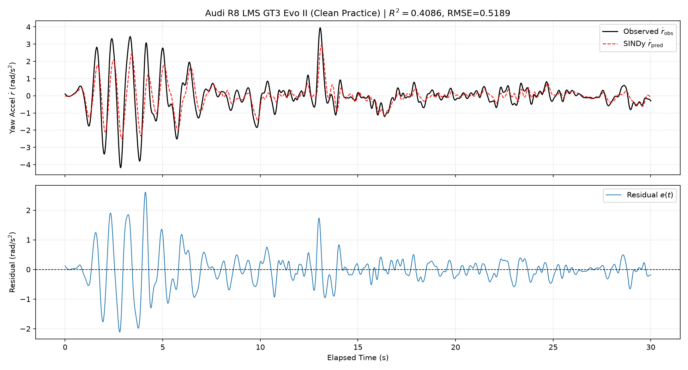
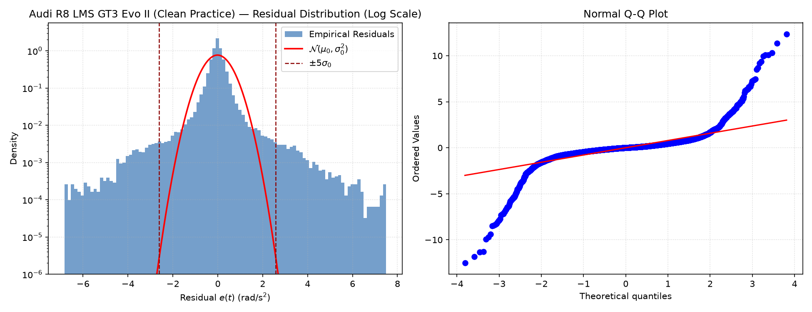
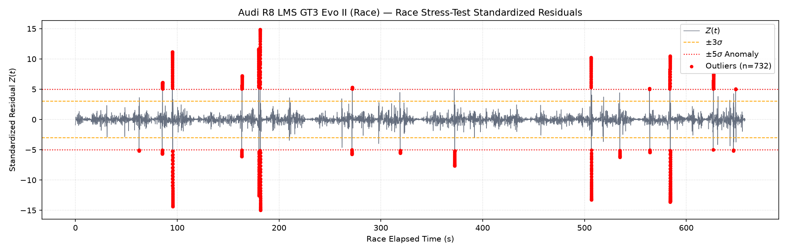
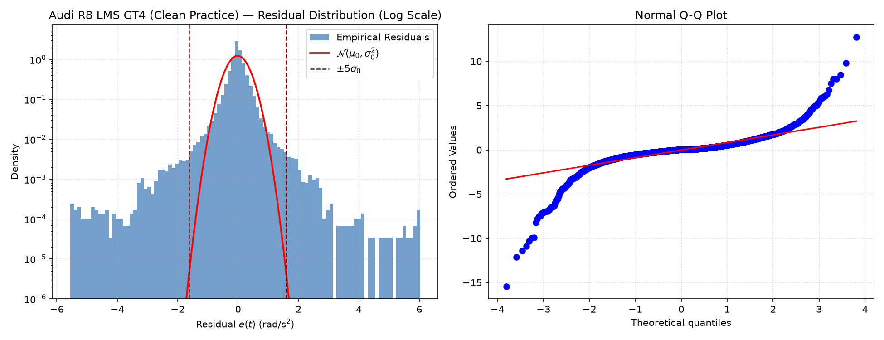

# SINDy-PIML: Physics-Informed Sparse Identification of Vehicle Dynamics

Data-driven discovery of governing vehicle dynamics equations from high-resolution **200 Hz Assetto Corsa Competizione (ACC) MoTeC telemetry** using **PySINDy** and physics-informed candidate libraries.

---

## Engineering Evolution & 4-Stage Modeling Roadmap

This project systematically climbs the vehicle-dynamics modeling hierarchy—from raw driver inputs to whole-car planar mechanics, to single-wheel contact-patch grip, and ultimately to full-chassis suspension setup dynamics:

### Stage 1 — Driver-Input Kinematic Regression *(Deprecated)*
- **Approach**: Initial prototypes regressed coupled vehicle states (`SPEED`, `G_LAT`, `G_LON`, `ROTY`) directly against raw driver inputs (`STEERANGLE`, `THROTTLE`, `BRAKE`) using generic polynomials.
- **Why Deprecated**: Driver control inputs decouple from chassis response whenever tires saturate (mid-corner understeer, counter-steering, TC/ABS interventions, dirty air, and traffic in race stints), creating severe non-stationary variance and unphysical terms.

### Stage 2 — Whole-Vehicle Planar Force Dynamics *(Current Milestone)*
- **Physical Rationale**: Shift to an outcome-driven, force-state formulation ($[a_y, a_x, v, \eta_P] \to \dot{r}$). Longitudinal acceleration $a_x$ implicitly captures longitudinal pitch and front/rear load transfer; lateral acceleration $a_y$ and lateral jerk $\dot{a}_y$ capture lateral roll, transient tire-force buildup, and cornering curvature; and four-wheel mean hot pressure $\bar{P}(t)$ enters through a Gaussian tire grip factor $\eta_P(t)$:
  $$\dot{r} = f\left(r,\; a_y,\; \dot{a}_y,\; \frac{\dot{a}_y}{v},\; (a_y - v r),\; a_y|a_x|,\; \frac{a_y(a_x^2 + a_y^2)}{\eta_P^2},\; r|r|\right)$$
- **Finding & Ceiling**: While widening the Savitzky-Golay filter (`window=81`, $0.405\text{ s}$) and introducing transient lateral force terms lifted clean-lap $R^2$ from `~0.05` to `0.4086` (GT3) and `0.5251` (GT4), whole-car lumped modeling still treats the four tires as a single rigid body—leaving curb strikes, asymmetric wheel unloading, and suspension bottoming unresolved. This ceiling directly motivates Stage 3.

### Stage 3 — Single-Wheel & Suspension Contact-Patch Modeling *(Next Focus)*
- **Physical Architecture (`WheelCornerLibrary`)**: Decompose dynamics down to individual corners (`LF`, `RF`, `LR`, `RR`) to isolate how wheel and suspension behavior govern tire grip:
  - Normal load $F_z(t)$ estimated from vehicle mass distribution, pitch/roll load transfer ($a_x, a_y, h_{\mathrm{cg}}, L, W$), and speed-dependent aerodynamic downforce ($\propto v^2$).
  - Direct telemetry integration of corner suspension travel (`SUS_TRAVEL_*`), bumpstop engagement (`BUMPSTOP_FORCE_*`), wheel slip (`WHEEL_SPEED_*`), and carcass pressure/temperature (`TYRE_PRESS_*`, `TYRE_TAIR_*`).

### Stage 4 — Full-Chassis & Setup Parameterized Dynamics *(Future Goal)*
- **Physical Architecture (`FullChassisLibrary` + `ChassisSetupSpec`)**: Couple all four wheel corners with explicit garage setup parameters—caster, per-wheel camber and toe angles, wheel rates, front/rear anti-roll bars (ARBs), bump/rebound damping, and aerodynamic rake—to explain setup sensitivity directly from track telemetry.

---

## Stage 2 Benchmark Results (Circuit de Barcelona-Catalunya)

Controlled mid-engine V10 comparison between **Audi R8 LMS GT3 Evo II** (high aerodynamic downforce) and **Audi R8 LMS GT4** (mechanical-grip baseline):

| Metric | Audi R8 LMS GT3 Evo II | Audi R8 LMS GT4 |
| :--- | :---: | :---: |
| **Clean Practice Samples** | `215,563` | `251,723` |
| **Clean Practice $R^2$ / RMSE** | **`0.4086`** / `0.5189 rad/s²` | **`0.5251`** / `0.3208 rad/s²` |
| **Race Stress-Test Samples** | `131,557` | `141,960` |
| **Race $R^2$ / RMSE** | `0.4457` / `0.4802 rad/s²` | `0.4227` / `0.4019 rad/s²` |
| **Top Block-Bootstrap Terms** | `a_y_dot/v` ($p = 7.65\times 10^{-15}$)<br>`a_y_dot` ($p = 6.06\times 10^{-5}$) | `a_y_dot` ($p = 2.77\times 10^{-4}$)<br>`a_y - v*r` ($p = 0.014$) |
| **Race $\pm 3\sigma_0$ Coverage** | `98.73%` | `97.68%` |
| **Race $>5\sigma_0$ Anomalies** | `732` frames (Gaussian exp: `0.08`) | `1,412` frames (Gaussian exp: `0.08`) |
| **Top Anomaly Corners** | `T9 Campsa` (261), `Sector 3` (141), `T5 Seat` (118) | `Sector 3` (684), `T3 Renault` (331), `T7-T8` (190) |

### Diagnostic Visualizations

#### Audi R8 LMS GT3 Evo II




#### Audi R8 LMS GT4




---

## Repository Structure

```text
SINDy-PIML/
├── configs/
│   ├── cars/
│   │   ├── audi_r8_gt3_evo2/
│   │   │   ├── vehicle.yaml      # Chassis constants, aero_baseline, black-box calibration slots
│   │   │   ├── convert_setup.py  # ACC setup .json -> .yaml converter for GT3 Evo II
│   │   │   └── setups/
│   │   │       └── Barcelona/    # Track-grouped setups matching ACC profile names (R8_A.json, r8_A.yaml)
│   │   └── audi_r8_gt4/
│   │       ├── vehicle.yaml      # GT4 chassis constants, aero_baseline, calibration slots
│   │       ├── convert_setup.py  # ACC setup .json -> .yaml converter for GT4
│   │       └── setups/
│   │           └── Barcelona/    # Track-grouped setups matching ACC profile names (a1.json, a1.yaml)
│   ├── tracks/                   # Circuit metadata & corner distance boundaries
│   ├── curation/                 # Savitzky-Golay & session-trimming presets
│   ├── modeling/                 # SINDy optimizer & statistical validation presets
│   └── experiments/
│       ├── stage2_planar_force/  # Stage 2 whole-vehicle planar force manifests
│       ├── stage3_wheel_corner/  # Reserved for Stage 3 single-wheel manifests
│       └── stage4_full_chassis/  # Reserved for Stage 4 full-chassis manifests
├── data/                         # MoTeC telemetry (.csv/.ld/.ldx, gitignored; see data/README.md)
├── models/                       # Exported sparse ODE models (.json)
├── outputs/                      # Diagnostic plots (.png) and validation reports (.json)
├── notebooks/                    # End-to-end showcase notebook (showcase.ipynb)
├── src/
│   └── sindy_piml/
│       ├── cli.py                # Modular CLI entry point (`sindy-piml`)
│       ├── config.py             # Composable YAML loader (Car, Setup, Track, Curation, Modeling)
│       ├── data/                 # MoTeC parser, session trimming, SG curation, ACC setup conversion
│       ├── features/
│       │   ├── base.py           # Abstract CandidateLibrary interface
│       │   ├── planar_force.py   # Stage 2: Whole-vehicle planar force library
│       │   ├── wheel_corner.py   # Stage 3: Single-wheel load-transfer & suspension schema
│       │   └── full_chassis.py   # Stage 4: Full-chassis & setup parameter interface
│       ├── modeling/             # PySINDy STLSQ trainer & evaluator
│       ├── stats/                # Normality/omission sweeps, Block Bootstrap, corner anomaly mapping
│       └── visualization/        # Residual Q-Q, time-series fit, and race anomaly plots
├── tests/                        # Pytest unit tests
└── pyproject.toml
```

## Naming Conventions

To prevent mismatches between ACC setups, MoTeC telemetry exports, and experiment configs:

- **Per-Car Setups**: `configs/cars/<vehicle_id>/setups/<Track>/<profile>.yaml`
  - Example: `configs/cars/audi_r8_gt3_evo2/setups/Barcelona/r8_A.yaml` (paired with `R8_A.json`)
- **Telemetry CSVs**: `data/<track>__<car>__<setupProfile>__<session>.csv`
  - Example: `data/barcelona_catalunya__audi_r8_gt3_evo2__r8_A__practice.csv`
- **Experiments & Outputs**: `configs/experiments/stage<N>_*/<track>__<car>__<setupProfile>.yaml`

## Installation & Usage

```bash
pip install -e ".[dev]"
pytest

# Run a Stage 2 experiment manifest
sindy-piml --config configs/experiments/stage2_planar_force/barcelona__audi_r8_gt3_evo2__r8_A.yaml
sindy-piml --config configs/experiments/stage2_planar_force/barcelona__audi_r8_gt4__a1.yaml

# Or swap individual modular configs on the fly
sindy-piml --config configs/experiments/stage2_planar_force/barcelona__audi_r8_gt3_evo2__r8_A.yaml \
  --car configs/cars/audi_r8_gt4/vehicle.yaml \
  --setup configs/cars/audi_r8_gt4/setups/Barcelona/a1.yaml

# Convert an ACC setup .json into repository setup YAML format
python configs/cars/audi_r8_gt3_evo2/convert_setup.py \
  configs/cars/audi_r8_gt3_evo2/setups/Barcelona/R8_A.json \
  -o configs/cars/audi_r8_gt3_evo2/setups/Barcelona/r8_A.yaml
```
