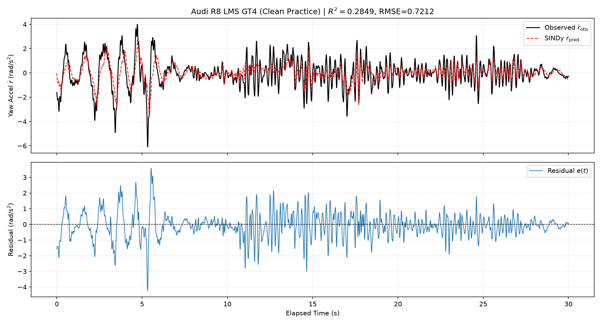
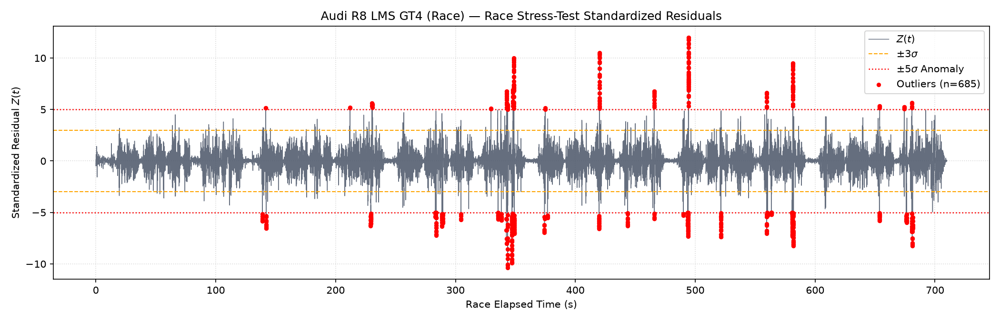

# ACC_Modeling: Multi-Stage Vehicle Dynamics Modeling & Telemetry Calibration

Physics-informed vehicle dynamics modeling, black-box setup calibration, and benchmark identification from high-resolution **200 Hz Assetto Corsa Competizione (ACC) MoTeC telemetry**.

---

## Engineering Evolution & 4-Stage Modeling Roadmap

This project systematically climbs the vehicle-dynamics modeling hierarchy—using **Stage 2 (SINDy)** as a sparse whole-vehicle benchmark, then moving to **standard physics-based / nonlinear identification** in Stages 3 and 4 rather than restricting the pipeline to SINDy:

### Stage 1 — Driver-Input Kinematic Regression *(Deprecated)*
- **Approach**: Initial prototypes regressed coupled vehicle states (`SPEED`, `G_LAT`, `G_LON`, `ROTY`) directly against raw driver inputs (`STEERANGLE`, `THROTTLE`, `BRAKE`) using generic polynomials.
- **Why Deprecated**: Driver control inputs decouple from chassis response whenever tires saturate (mid-corner understeer, counter-steering, TC/ABS interventions, dirty air, and traffic in race stints), creating severe non-stationary variance and unphysical terms.

### Stage 2 — Whole-Vehicle Planar Force SINDy *(Completed Benchmark)*
- **Physical Rationale**: Shift to an outcome-driven, force-state formulation ($[a_y, a_x, v, \eta_P] \to \dot{r}$) identified via **PySINDy (`STLSQ`)**. Longitudinal acceleration $a_x$ implicitly captures longitudinal pitch and front/rear load transfer; lateral acceleration $a_y$ and lateral jerk $\dot{a}_y$ capture lateral roll, transient tire-force buildup, and cornering curvature; and four-wheel mean hot pressure $\bar{P}(t)$ enters through a Gaussian tire grip factor $\eta_P(t)$:
  $$\dot{r} = f\left(r,\; a_y,\; \dot{a}_y,\; \frac{\dot{a}_y}{v},\; (a_y - v r),\; a_y|a_x|,\; \frac{a_y(a_x^2 + a_y^2)}{\eta_P^2},\; r|r|\right)$$
- **Finding & Benchmark Role**: Widening the Savitzky-Golay filter (`window=81`, $0.405\text{ s}$) and introducing transient lateral force terms lifted clean-lap $R^2$ from `~0.05` to `0.4086` (GT3) and `0.5251` (GT4). However, whole-car lumped SINDy treats the four tires as a single rigid body—leaving curb strikes, asymmetric wheel unloading, and suspension bottoming unresolved. Stage 2 now serves as our **baseline benchmark** for evaluating Stages 3 and 4.

### Stage 3 — Single-Wheel & Suspension Contact-Patch Modeling *(Next Focus — Standard Physics / Nonlinear Modeling)*
- **Modeling Choice**: Rather than forcing SINDy sparse polynomials, Stage 3 applies **standard first-principles and nonlinear vehicle-dynamics modeling** (e.g., Pacejka/brush tire-force curves, nonlinear least squares, and per-corner vertical/lateral force balance) directly benchmarked against Stage 2 SINDy.
- **Physical Architecture (`WheelCornerLibrary`)**: Decompose dynamics down to individual corners (`LF`, `RF`, `LR`, `RR`) using the calibrated vehicle parameters:
  - Normal load $F_z(t)$ from mass distribution, pitch/roll load transfer ($a_x, a_y, h_{\mathrm{cg}}, L, W$), ARB roll distribution, and speed-dependent aerodynamic downforce ($\propto v^2$).
  - Direct telemetry integration of corner suspension travel (`SUS_TRAVEL_*`), bumpstop engagement (`BUMPSTOP_FORCE_*`, `BUMPSTOPUP_RIDE_*`), wheel slip (`WHEEL_SPEED_*`), and carcass pressure/temperature (`TYRE_PRESS_*`, `TYRE_TAIR_*`).

#### Black-Box Setup Parameter Calibration *(Click-to-SI Identification)*
Because ACC exposes most garage settings as integer UI clicks, [calibration/blackbox.py](src/calibration/blackbox.py) identifies physical parameters for `configs/cars/<vehicle_id>/vehicle.yaml` from controlled single-variable Hotlap telemetry using the **`click = 0` intercept convention** $y(\text{click}) = y_{\text{base}} + k \cdot \text{click}$:
- **Aerodynamics (`aero_baseline`, `aero_clicks`, dimensionless $C_L, C_D$)**: Identifies $C_L$ and front aero balance from pitch-corrected straight-line spring compression $\Delta F_z = k_w \Delta z \propto \frac{1}{2}\rho A v^2$, and separates rear-wing, front brake-duct, and rear brake-duct $\Delta C_D$ via speed-matched full-throttle acceleration differences $\Delta F_d = -m \Delta a_x$.
- **Bumpstop Engagement (`bumpstop_range_mm`, unit: $\mathrm{mm}$)**: Solves the linear engagement `SUS_TRAVEL` threshold where `BUMPSTOPUP_RIDE == 1` across two bumpstop window settings.
- **Anti-Roll Bars (`arb_stiffness_n_m`, unit: $\mathrm{N/m}$ at wheel)**: Extracts differential wheel-referenced roll stiffness $K_{\mathrm{roll,diff}} - k_w$ from steady-state cornering roll gradients $|\Delta z_{\mathrm{L-R}} / a_y|$ with bumpstop-free filtering.
- **Virtual Damper Dyno (`dampers_n_s_m`, unit: $\mathrm{N\cdot s/m}$ at wheel)**: Extracts bump/rebound and slow/fast damping around `knee_velocity_mps = 0.05 m/s` using high-pass half-cycle logarithmic ringdown $\zeta = \ln(z_1/z_2)/\pi,\; c = 2\zeta\sqrt{k_w m_{\mathrm{corner}}}$.

### Stage 4 — Full-Chassis & Setup Parameterized Dynamics *(Future Goal)*
- **Physical Architecture (`FullChassisLibrary` + `ChassisSetupSpec`)**: Couple all four wheel corners with explicit garage setup parameters—caster, per-wheel camber and toe angles, wheel rates, front/rear anti-roll bars (ARBs), bump/rebound damping, and aerodynamic rake—to model setup sensitivity directly from track telemetry and compare against Stage 2/3.

---

## Stage 2 Benchmark Results (Circuit de Barcelona-Catalunya)

Controlled mid-engine V10 SINDy benchmark between **Audi R8 LMS GT3 Evo II** (high aerodynamic downforce) and **Audi R8 LMS GT4** (mechanical-grip baseline):

| Metric | Audi R8 LMS GT3 Evo II | Audi R8 LMS GT4 |
| :--- | :---: | :---: |
| **Clean Practice Samples** | `215,563` | `251,723` |
| **Clean Practice $R^2$ / RMSE** | **`0.4086`** / `0.5189 rad/s²` | **`0.5251`** / `0.3208 rad/s²` |
| **Race Stress-Test Samples** | `131,557` | `141,960` |
| **Race $R^2$ / RMSE** | `0.4457` / `0.4802 rad/s²` | `0.4227` / `0.4019 rad/s²` |
| **Top Block-Bootstrap Terms** | `a_y_dot/v` ($p = 7.65\times 10^{-15}$)<br>`a_y_dot` ($p = 6.06\times 10^{-5}$) | `a_y_dot` ($p = 2.77\times 10^{-4}$)<br>`a_y - v*r` ($p = 0.014$) |
| **Race $\pm 3\sigma_0$ Coverage** | `98.73%` | `97.68%` |
| **Race $>5\sigma_0$ Anomalies** | `732` frames (Gaussian exp: `0.08`) | `1,412` frames (Gaussian exp: `0.08`) |
| **Top Anomaly Corners** | `T9 Campsa` (261), `Sector 3` (141), `T5 Seat` (118) | `Sector 3` (684), `T3 Renault` (331), `T7-T8` (190) |

### Diagnostic Visualizations

#### Audi R8 LMS GT3 Evo II


#### Audi R8 LMS GT4




---

## Repository Structure

```text
ACC_Modeling/
├── configs/
│   ├── cars/
│   │   ├── audi_r8_gt3_evo2/
│   │   │   ├── vehicle.yaml      # Chassis constants, aero_baseline, calibrated click-to-SI slots
│   │   │   ├── convert_setup.py  # ACC setup .json -> .yaml converter for GT3 Evo II
│   │   │   └── setups/
│   │   │       └── Barcelona/    # Track-grouped setups matching ACC profile names (R8_A.json, r8_A.yaml)
│   │   └── audi_r8_gt4/
│   │       ├── vehicle.yaml      # GT4 chassis constants, aero_baseline, calibration slots
│   │       ├── convert_setup.py  # ACC setup .json -> .yaml converter for GT4
│   │       └── setups/
│   │           └── Barcelona/    # Track-grouped setups matching ACC profile names (a1.json, a1.yaml)
│   ├── tracks/                   # Circuit metadata & corner distance boundaries
│   ├── curation/                 # Savitzky-Golay & session-trimming presets
│   ├── modeling/                 # Identification optimizer & statistical validation presets
│   └── experiments/
│       ├── stage2_planar_force/  # Stage 2 whole-vehicle planar force SINDy manifests
│       ├── stage3_wheel_corner/  # Reserved for Stage 3 single-wheel manifests
│       └── stage4_full_chassis/  # Reserved for Stage 4 full-chassis manifests
├── data/                         # MoTeC telemetry (.csv/.ld/.ldx, gitignored; see data/README.md)
│   └── calibration/              # Controlled single-variable Hotlap CSVs for black-box calibration
├── models/                       # Exported Stage 2 sparse ODE models (.json)
├── outputs/
│   ├── calibration/                                # Black-box identification reports (.json)
│   ├── stage2_barcelona_gt3_r8_A/                  # GT3 Stage 2 practice vs. race diagnostic plots & report
│   ├── stage2_barcelona_gt4_a1/                    # GT4 Stage 2 practice vs. race diagnostic plots & report
│   └── stage2final_barcelona_gt3_r8_A_hotlap_10l/  # Stage 2 Final (10L GT3 Hotlap) SINDy benchmark plots & report
├── notebooks/
│   ├── stage2_showcase.ipynb                       # Stage 2 GT3 vs. GT4 practice & race stress-test showcase
│   └── stage2_final_gt3_hotlap.ipynb               # Stage 2 Final (10L GT3 Hotlap) SINDy benchmark for Stage 3/4 comparison
├── src/
│   ├── cli.py                    # Modular CLI entry point (`acc-modeling`)
│   ├── config.py                 # Composable YAML loader (Car, Setup, Track, Curation, Modeling)
│   ├── calibration/              # Click-to-SI black-box calibration from controlled Hotlap telemetry
│   ├── data/                     # MoTeC parser, session trimming, SG curation, ACC setup conversion
│   ├── features/
│   │   ├── base.py               # Abstract CandidateLibrary / feature-matrix interface
│   │   ├── planar_force.py       # Stage 2: Whole-vehicle planar force SINDy library
│   │   ├── wheel_corner.py       # Stage 3: Single-wheel load-transfer & suspension schema
│   │   └── full_chassis.py       # Stage 4: Full-chassis & setup parameter interface
│   ├── modeling/                 # Stage 2 SINDy STLSQ trainer & evaluator
│   ├── stats/                    # Normality/omission sweeps, Block Bootstrap, corner anomaly mapping
│   └── visualization/            # Residual Q-Q, time-series fit, and race anomaly plots
├── tests/                        # Pytest unit & calibration tests
└── pyproject.toml
```

## Naming Conventions

To prevent mismatches between ACC setups, MoTeC telemetry exports, and experiment configs:

- **Per-Car Setups**: `configs/cars/<vehicle_id>/setups/<Track>/<profile>.yaml`
  - Example: `configs/cars/audi_r8_gt3_evo2/setups/Barcelona/r8_A.yaml` (paired with `R8_A.json`)
- **Telemetry CSVs**: `data/<track>__<car>__<setupProfile>__<session>.csv`
  - Example: `data/barcelona_catalunya__audi_r8_gt3_evo2__r8_A__practice.csv`
- **Experiments & Outputs**: `configs/experiments/stage<N>_*/<track>__<car>__<setupProfile>.yaml`

## Installation & Usage

```bash
pip install -e ".[dev]"
pytest

# Run a Stage 2 SINDy benchmark experiment
acc-modeling --config configs/experiments/stage2_planar_force/barcelona__audi_r8_gt3_evo2__r8_A.yaml
acc-modeling --config configs/experiments/stage2_planar_force/barcelona__audi_r8_gt4__a1.yaml

# Or swap individual modular configs on the fly
acc-modeling --config configs/experiments/stage2_planar_force/barcelona__audi_r8_gt3_evo2__r8_A.yaml \
  --car configs/cars/audi_r8_gt4/vehicle.yaml \
  --setup configs/cars/audi_r8_gt4/setups/Barcelona/a1.yaml

# Convert an ACC setup .json into repository setup YAML format
python configs/cars/audi_r8_gt3_evo2/convert_setup.py \
  configs/cars/audi_r8_gt3_evo2/setups/Barcelona/R8_A.json \
  -o configs/cars/audi_r8_gt3_evo2/setups/Barcelona/r8_A.yaml
```
